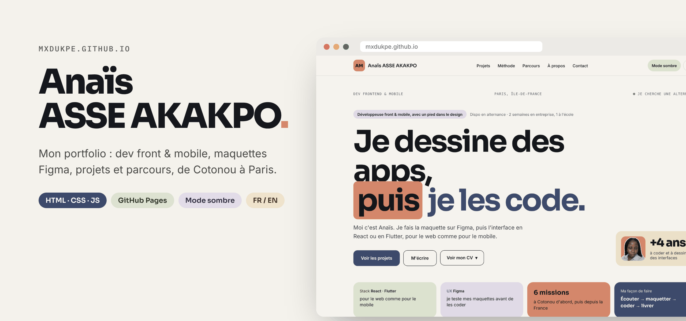

<p align="center">
  
</p>

# Portfolio · Anaïs ASSE AKAKPO

Mon portfolio en ligne : développeuse front & mobile avec un pied dans le design. Je fais la maquette sur Figma, puis l'interface en React ou en Flutter.

👉 **En ligne : [mxdukpe.github.io](https://mxdukpe.github.io)**

## Ce qu'on y trouve

- **Projets** : une sélection de missions et de projets perso
- **Méthode** : écouter → maquetter → coder → livrer
- **Parcours** : de Cotonou à Paris
- **CV** téléchargeable en deux versions (classique et design)
- Mode sombre et version anglaise

## Stack

HTML, CSS et JavaScript, sans framework ni build. Hébergé sur GitHub Pages.

## Lancer en local

```bash
npx serve .
```

## Structure

```
index.html   tout le site (styles + logique)
assets/      portrait et visuels des projets
cv/          CV en PDF
```
